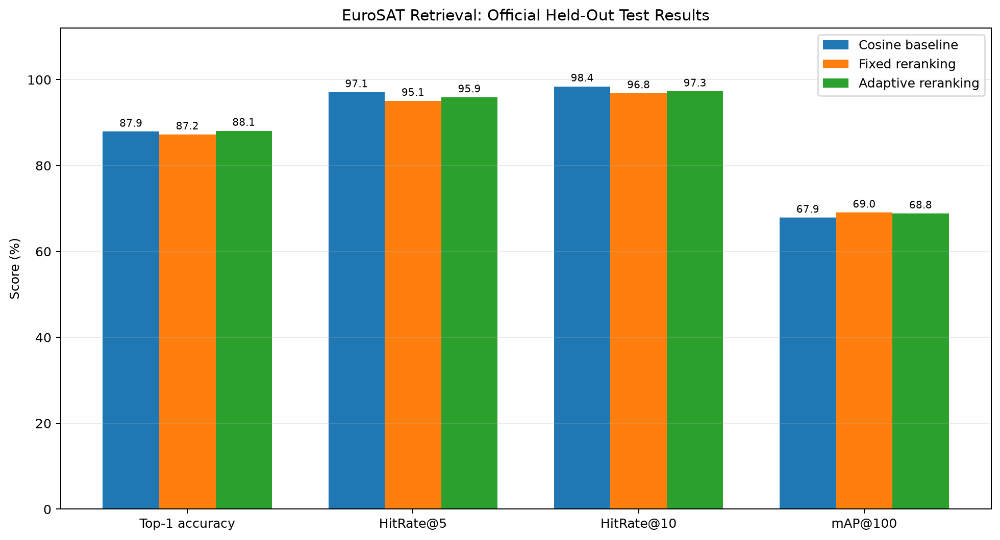

# GeoFuse-R: Satellite Scene Retrieval with Reciprocal-Neighbor Reranking

A reproducible research study evaluating fixed and query-adaptive reciprocal-neighbor reranking for satellite-scene image retrieval.

## Research question

Can reciprocal-neighbor relationships improve the overall ranking of relevant satellite scenes beyond cosine-similarity retrieval using frozen ImageNet-pretrained visual features? How does reranking affect the first few retrieved results compared with overall ranking quality?

## Method

The retrieval pipeline uses:

1. **Feature extraction:** ImageNet-pretrained ResNet-18 with its classification head removed.
2. **Embedding normalization:** L2-normalized 512-dimensional image embeddings.
3. **Initial retrieval:** Exact cosine-similarity search using FAISS inner-product search.
4. **Fixed reciprocal reranking:** Combines initial similarity with reciprocal-neighborhood Jaccard overlap using a fixed weight.
5. **Adaptive reciprocal reranking:** Adjusts the similarity weight using the gap between the first and second cosine-similarity scores.

The adaptive weighting rule is an experimental heuristic. It is not a calibrated estimate of retrieval correctness, and its novelty has not been established.

## Dataset and evaluation protocol

- **Dataset:** EuroSAT RGB, loaded from `timm/eurosat-rgb`.
- **Gallery:** Official training split - 16,200 images.
- **Validation queries:** Official validation split - 5,400 images.
- **Test queries:** Official test split - 5,400 images.
- **Encoder:** Frozen ImageNet-pretrained ResNet-18.
- **Embedding dimension:** 512.
- **Input image size:** 128 x 128 pixels.
- **Retrieval candidate pool:** Top 100 candidates per query.
- **Reciprocal neighborhood size:** 20.

The training split is the retrieval gallery. Reranking parameters are selected using validation mAP@100, and the selected configurations are then evaluated on the held-out test split.

The recorded experiment selected fixed alpha = 0.50 and adaptive temperature = 0.20, with adaptive alpha bounds of 0.70 and 0.95.

## Metrics

- **Top-1 accuracy:** Fraction of queries whose first retrieved image has the same class label.
- **HitRate@5:** Fraction of queries with at least one same-class image among the first five results.
- **HitRate@10:** Fraction of queries with at least one same-class image among the first ten results.
- **mAP@100:** Mean average precision truncated at 100, normalized by the number of relevant gallery images or 100, whichever is smaller.

These are class-label retrieval metrics. They do not establish geographic similarity, spatial proximity, or semantic equivalence beyond the dataset labels.

## Held-out test results

| Method | Top-1 | Hit@5 | Hit@10 | mAP@100 |
|---|---:|---:|---:|---:|
| Cosine baseline | 0.8789 | 0.9707 | 0.9843 | 0.6786 |
| Fixed reciprocal reranking | 0.8724 | 0.9507 | 0.9683 | **0.6905** |
| Adaptive reciprocal reranking | **0.8811** | 0.9589 | 0.9726 | 0.6884 |



The results show a trade-off: both reranking methods improve mAP@100 while reducing HitRate@5 and HitRate@10. The adaptive method has the highest observed Top-1 accuracy, but its difference from the baseline is inconclusive under the reported bootstrap analysis.

## Paired bootstrap analysis

A class-stratified paired bootstrap with 2,000 replicates estimates uncertainty in method-minus-baseline differences on the test queries.

| Method | Metric | Difference | 95% CI |
|---|---|---:|---:|
| Fixed | Top-1 | -0.00648 | [-0.01426, 0.00148] |
| Fixed | Hit@5 | -0.02000 | [-0.02444, -0.01593] |
| Fixed | Hit@10 | -0.01593 | [-0.01944, -0.01259] |
| Fixed | mAP@100 | +0.01185 | [+0.01124, +0.01241] |
| Adaptive | Top-1 | +0.00222 | [-0.00463, +0.00907] |
| Adaptive | Hit@5 | -0.01185 | [-0.01537, -0.00833] |
| Adaptive | Hit@10 | -0.01167 | [-0.01482, -0.00870] |
| Adaptive | mAP@100 | +0.00981 | [+0.00936, +0.01027] |

The intervals exclude zero for both methods' mAP@100 gains and HitRate@5/10 decreases. The Top-1 differences remain inconclusive.

These intervals quantify query-sampling uncertainty conditional on the chosen gallery, encoder, dataset split, and validation-selected parameters. They do not establish generalization to other datasets or encoders.

## Repository layout

```text
configs/       Experiment configuration
scripts/       Baseline, reranking, bootstrap, and analysis scripts
src/           Retrieval, encoding, metrics, and reranking modules
tests/         Automated unit tests
results/       Generated metrics and figures
```

## Setup

Use Python 3.11 in a virtual environment.

```powershell
python -m venv .venv
.\.venv\Scripts\Activate.ps1
python -m pip install -r requirements.txt
```

Install PyTorch and torchvision using the instructions appropriate for your operating system and hardware: https://pytorch.org/get-started/locally/

## Reproduction

Run the automated tests:

```powershell
python -m pytest -q
```

Run the validation-selected retrieval experiment:

```powershell
python .\scripts\run_reranking.py
```

Run the paired-bootstrap analysis:

```powershell
python .\scripts\analyze_bootstrap.py
```

Generate figures from saved metrics:

```powershell
python .\scripts\generate_figures.py
```

Inspect representative baseline retrieval failures:

```powershell
python .\scripts\inspect_failures.py
```

The scripts download the dataset and pretrained encoder weights as needed. Initial runs require network access and sufficient disk space. Generated outputs are saved under `results/metrics/` and `results/figures/`.

The saved official-split JSON files record the selected parameters and evaluation results. Because the older exploratory outputs use a different gallery/query configuration, they should not be interpreted as results from the official-split experiment.

## Limitations

- The encoder is pretrained on ImageNet, not fine-tuned for remote sensing.
- Evaluation uses one dataset, one gallery, and one encoder.
- Retrieval correctness is based on scene class labels, not geographic location.
- Reciprocal-neighbor reranking is an established family of methods; this project does not claim to introduce the general concept.
- The adaptive weighting rule is heuristic and requires further validation.
- Bootstrap intervals reflect query-sampling uncertainty, not uncertainty across datasets, encoders, or independent training runs.
- No claim of state-of-the-art performance is made.

## Project status

Research prototype with a held-out evaluation, uncertainty analysis, and reproducibility checks. Further validation on additional datasets and encoders is needed before drawing broader conclusions.